# Markdown 完整语法测试文档

本文档是 ErgeMD 的 Markdown 渲染完整性测试样例，按「基础语法 → 转义字符 → 代码 → 表格 → 数学公式 → Mermaid 图表 → 扩展语法」的顺序组织，共十五章。每节开头附有一段说明，概括该节的测试范围与检查要点，其后跟随对应的语法样例。

使用方法：在浅色与深色两种模式下分别打开本文档，并切换各个主题重复核对；发现渲染异常时，记录异常节号与当前主题名即可快速定位回归范围。文中标注「已知上游问题」的现象为上游缺陷，重现时不构成新回归。

## 一、基础语法

本章覆盖 Markdown 最常用的基础元素：六级标题、段落与换行、强调样式、引用、各类列表、分割线、链接与图片。它们是所有复杂结构的组成单元，任何一项渲染异常都会在真实文档中被放大，因此优先逐项核对。所有主题下的通用预期：文字颜色跟随主题变量，间距与字号梯度保持一致，不出现明暗主题下不可读的文字。

### 1.1 标题

以下样例依次展示一级至六级标题。检查要点：六级标题的字号是否呈梯度递减；标题与上下文的间距是否均匀；标题颜色是否跟随主题；各级标题能否正确生成目录条目与页内锚点（与第九章联动验证）。

# 一级标题

## 二级标题

### 三级标题

#### 四级标题

##### 五级标题

###### 六级标题

### 1.2 段落与换行

以下样例演示段落的两种分隔方式。检查要点：空行分隔的两个段落之间是否有正确间距；行尾反斜杠造成的硬换行是否生效且不产生多余空隙；中英文混排段落的行高与折行位置是否均匀。

这是一段普通文本。段落之间用空行分隔。

这是第二段普通文本。\
这行使用了两个空格换行（上一行末尾有两个空格）。

### 1.3 强调

以下样例覆盖全部行内强调样式及其组合。检查要点：粗体、斜体、删除线、行内代码的字重与颜色是否清晰可辨；行内代码是否带有背景色与圆角；「粗体嵌套行内代码」「链接嵌在强调内」等组合是否完整；kbd、samp、ins 等行内 HTML 元素是否有对应样式。

- **粗体文本** 使用双星号
- __粗体文本__ 使用双下划线
- *斜体文本* 使用单星号
- _斜体文本_ 使用单下划线
- ***粗斜体文本*** 使用三星号
- ~~删除线文本~~ 使用双波浪号
- 这是行内代码：`console.log("Hello")`
- 这是 **粗体里有 `inline code`** 的组合。
- 这是 `https://example.com` 和 **`https://example.com`**。
- 这是一个普通链接：https://example.com 。
- 这是 ==mark 如果渲染支持== 或 HTML <mark>高亮文本</mark>。
- 请按 <kbd>Ctrl</kbd> + <kbd>S</kbd> 保存。
- 这是 <samp>sample output</samp>。
- 这是 <ins>插入文本</ins>。

### 1.4 引用

以下样例演示引用块及其多级嵌套。检查要点：引用块是否有左侧竖线与背景色；多级嵌套的缩进是否逐级递增；引用内部包含列表、行内代码与加粗时是否照常渲染。

> 这是一级引用
>
> > 这是二级引用
> >
> > > 这是三级引用

> **注意**：引用中也可以使用其他 Markdown 语法
>
> - 列表项一
> - 列表项二
> - `代码` 也可以

### 1.5 列表

以下样例演示四种列表结构。检查要点：无序列表多级嵌套的缩进与项目符号是否逐级变化；有序列表的数字是否连续、嵌套层是否重新计数；任务列表的复选框是否呈现，并确认点击是否可交互；定义列表若暂不支持，确认其降级为普通段落而非显示乱码。

无序列表：

- 项目一
  - 子项目 1.1
    - 子子项目 1.1.1
  - 子项目 1.2
- 项目二
- 项目三

有序列表：

1. 第一步
2. 第二步
   1. 子步骤 2.1
   2. 子步骤 2.2---
3. 第三步

任务列表：

- [x] 已完成的任务
- [x] 另一个已完成的任务
- [ ] 未完成的任务
- [ ] 另一个未完成的任务

定义列表（部分解析器支持）：

术语一
: 定义一的内容

术语二
: 定义二的内容

### 1.6 分割线

检查要点：分割线是否通栏渲染，粗细与颜色是否跟随主题；多个分割线相邻时间距是否均匀。

***

***

***

### 1.7 链接

以下样例演示四种链接写法。检查要点：链接是否有区别于正文的颜色；悬停是否有视觉反馈；带 title 的链接悬停时是否展示提示；两个引用式链接的定义是否能被正确解析为可点击链接而非纯文本。

行内链接：[百度](https://www.baidu.com)

带标题的链接：[Google](https://www.google.com "点击访问 Google")

直接URL：<https://www.example.com>

邮箱链接：<contact@example.com>

引用式链接：

[引用链接一](https://www.example.com "示例网站")
[引用链接二](https://www.example.org "另一个示例")

### 1.8 图片

以下样例演示四种图片用法。检查要点：图片能否加载并保持宽高比；加载失败时是否有占位或 alt 文本兜底；title 悬停提示是否正常；「带链接的图片」整体是否可点击并跳转。

行内图片：


引用式图片：


带链接的图片：

[](https://space.bilibili.com/67221461)

远程图片：


***

## 二、转义字符

本章演示反斜杠转义与 HTML 特殊字符。检查要点：被转义的 `#`、`*`、`_`、`~`、`` ` ``、`|`、`\` 是否按字面显示而不触发对应语法；`&`、`<`、`>`、`"` 与 `©`、`®` 是否完整显示、不被吞掉。

\# 这不是标题\
\* 这不是斜体 \*\
\_ 这不是斜体 \_\
\~\~ 这不是删除线 \~\~\
\` 这不是代码 \`\
\ 这是反斜杠本身\
\| 这不是表格分隔符

特殊字符：& < > " © ®

***

## 三、代码

本章演示行内代码与多语言代码块，覆盖 Python、JavaScript、JSON、Bash、CSS、Rust、TypeScript、Go、Java、SQL 与 Diff 共 11 种。检查要点：每种语言的关键字、字符串与注释是否有区分度的高亮；代码块是否带语言标签与复制按钮；超长代码行是否出现横向滚动而非撑破布局。

### 3.1 行内代码

检查要点：行内代码与正文之间是否有合适的内边距；与中文字符相邻时不出现挤压、异常换行或背景溢出。

使用 `pip install requests` 安装依赖。变量名是 `count`。

### 3.2 代码块

以下按语言给出 11 个代码块样例。检查要点：语法高亮配色是否跟随主题；复制按钮（如有）可用；制表符与空行缩进保持原样；虚拟滚动场景下拉到长代码块底部不出现内容缺失。

```python
# Python 示例
import asyncio
from typing import List, Optional

async def fetch_data(url: str, timeout: int = 30) -> Optional[dict]:
    """异步获取数据"""
    import aiohttp
    async with aiohttp.ClientSession() as session:
        async with session.get(url, timeout=aiohttp.ClientTimeout(total=timeout)) as resp:
            if resp.status == 200:
                return await resp.json()
    return None

class DataProcessor:
    def __init__(self, data: List[dict]):
        self.data = data
        self._cache = {}

    @property
    def count(self) -> int:
        return len(self.data)

    def filter_by(self, key: str, value) -> List[dict]:
        return [item for item in self.data if item.get(key) == value]

if __name__ == "__main__":
    urls = ["https://api.example.com/data"] * 5
    results = asyncio.gather(*[fetch_data(url) for url in urls])
```

```javascript
// JavaScript 示例
class EventEmitter {
  #listeners = new Map();

  on(event, callback) {
    if (!this.#listeners.has(event)) {
      this.#listeners.set(event, []);
    }
    this.#listeners.get(event).push(callback);
    return () => this.off(event, callback);
  }

  off(event, callback) {
    const callbacks = this.#listeners.get(event);
    if (callbacks) {
      this.#listeners.set(event, callbacks.filter(cb => cb !== callback));
    }
  }

  emit(event, ...args) {
    const callbacks = this.#listeners.get(event);
    callbacks?.forEach(cb => cb(...args));
  }
}

const emitter = new EventEmitter();
const unsub = emitter.on('data', (payload) => console.log(payload));
emitter.emit('data', { message: 'Hello, World!' });
unsub();
```

```json
{
  "name": "Markdown 测试文档",
  "version": "1.0.0",
  "author": {
    "name": "张三",
    "email": "zhangsan@example.com"
  },
  "tags": ["markdown", "test", "demo"],
  "features": [
    { "name": "表格", "supported": true },
    { "name": "流程图", "supported": true },
    { "name": "数学公式", "supported": true }
  ]
}
```

```bash
#!/bin/bash
# Shell 脚本示例
echo "Starting deployment..."

ENV=${1:-production}
DEPLOY_DIR="/var/www/app"

# 停止服务
systemctl stop myapp.service

# 备份当前版本
tar -czf "backup_$(date +%Y%m%d_%H%M%S).tar.gz" "$DEPLOY_DIR"

# 部署新版本
rsync -avz --delete ./dist/ "$DEPLOY_DIR/"

# 重启服务
systemctl start myapp.service

echo "Deployment to $ENV completed!"
```

```css
/* CSS 示例 */
:root {
  --primary-color: #3b82f6;
  --bg-color: #f8fafc;
  --text-color: #1e293b;
  --border-radius: 8px;
}

.markdown-body {
  font-family: 'Inter', -apple-system, BlinkMacSystemFont, sans-serif;
  color: var(--text-color);
  background: var(--bg-color);
  line-height: 1.75;
  max-width: 800px;
  margin: 0 auto;
  padding: 2rem;
}

.markdown-body h1 {
  font-size: 2.25em;
  border-bottom: 2px solid var(--primary-color);
  padding-bottom: 0.3em;
}

.markdown-body code {
  background: #e2e8f0;
  padding: 0.2em 0.4em;
  border-radius: 3px;
  font-size: 0.875em;
}
```

```rust
// Rust 示例
fn main() {
    println!("Hello, ErgeMD!");
    
    let numbers = vec![1, 2, 3, 4, 5];
    let sum: i32 = numbers.iter().sum();
    println!("Sum: {}", sum);
    
    let result = divide(10, 2);
    match result {
        Some(value) => println!("Result: {}", value),
        None => println!("Cannot divide by zero"),
    }
}

fn divide(a: i32, b: i32) -> Option<i32> {
    if b == 0 {
        None
    } else {
        Some(a / b)
    }
}

#[derive(Debug)]
struct Point {
    x: i32,
    y: i32,
}

impl Point {
    fn new(x: i32, y: i32) -> Self {
        Point { x, y }
    }
    
    fn distance(&self, other: &Point) -> f64 {
        let dx = (self.x - other.x) as f64;
        let dy = (self.y - other.y) as f64;
        (dx * dx + dy * dy).sqrt()
    }
}
```

```typescript
// TypeScript 示例
interface User {
    id: number;
    name: string;
    email: string;
    isActive: boolean;
}

class UserService {
    private users: User[] = [];
    
    addUser(user: User): void {
        this.users.push(user);
    }
    
    getUserById(id: number): User | undefined {
        return this.users.find(u => u.id === id);
    }
    
    getActiveUsers(): User[] {
        return this.users.filter(u => u.isActive);
    }
    
    async fetchUsersFromAPI(url: string): Promise<User[]> {
        const response = await fetch(url);
        const data = await response.json();
        return data as User[];
    }
}

const service = new UserService();
service.addUser({ id: 1, name: "张三", email: "zhangsan@example.com", isActive: true });
service.addUser({ id: 2, name: "李四", email: "lisi@example.com", isActive: false });

console.log(service.getActiveUsers());
```

```go
// Go 示例
package main

import (
    "fmt"
    "time"
)

func main() {
    fmt.Println("Hello, ErgeMD!")
    
    now := time.Now()
    fmt.Printf("当前时间: %s\n", now.Format(time.RFC3339))
    
    numbers := []int{1, 2, 3, 4, 5}
    sum := 0
    for _, num := range numbers {
        sum += num
    }
    fmt.Printf("总和: %d\n", sum)
    
    result, err := divide(10, 2)
    if err != nil {
        fmt.Printf("错误: %v\n", err)
    } else {
        fmt.Printf("结果: %d\n", result)
    }
    
    p := NewPoint(3, 4)
    fmt.Printf("点: %v\n", p)
}

func divide(a, b int) (int, error) {
    if b == 0 {
        return 0, fmt.Errorf("不能除以零")
    }
    return a / b, nil
}

type Point struct {
    X, Y int
}

func NewPoint(x, y int) *Point {
    return &Point{X: x, Y: y}
}
```

```java
// Java 示例
import java.util.*;

public class UserService {
    private List<User> users = new ArrayList<>();
    
    public void addUser(User user) {
        users.add(user);
    }
    
    public Optional<User> getUserById(int id) {
        return users.stream()
            .filter(u -> u.getId() == id)
            .findFirst();
    }
    
    public List<User> getActiveUsers() {
        return users.stream()
            .filter(User::isActive)
            .toList();
    }
    
    public static void main(String[] args) {
        System.out.println("Hello, ErgeMD!");
        
        UserService service = new UserService();
        service.addUser(new User(1, "张三", "zhangsan@example.com", true));
        service.addUser(new User(2, "李四", "lisi@example.com", false));
        
        service.getActiveUsers().forEach(System.out::println);
    }
}

class User {
    private int id;
    private String name;
    private String email;
    private boolean active;
    
    public User(int id, String name, String email, boolean active) {
        this.id = id;
        this.name = name;
        this.email = email;
        this.active = active;
    }
    
    public int getId() { return id; }
    public String getName() { return name; }
    public String getEmail() { return email; }
    public boolean isActive() { return active; }
    
    @Override
    public String toString() {
        return String.format("User{id=%d, name='%s'}", id, name);
    }
}
```

```sql
-- SQL 示例
CREATE TABLE users (
    id INTEGER PRIMARY KEY AUTOINCREMENT,
    name TEXT NOT NULL,
    email TEXT UNIQUE NOT NULL,
    is_active BOOLEAN DEFAULT TRUE,
    created_at TIMESTAMP DEFAULT CURRENT_TIMESTAMP
);

CREATE TABLE orders (
    id INTEGER PRIMARY KEY AUTOINCREMENT,
    user_id INTEGER NOT NULL,
    total DECIMAL(10, 2) NOT NULL,
    status TEXT DEFAULT 'pending',
    created_at TIMESTAMP DEFAULT CURRENT_TIMESTAMP,
    FOREIGN KEY (user_id) REFERENCES users(id)
);

-- 插入数据
INSERT INTO users (name, email) VALUES 
('张三', 'zhangsan@example.com'),
('李四', 'lisi@example.com'),
('王五', 'wangwu@example.com');

INSERT INTO orders (user_id, total, status) VALUES 
(1, 99.99, 'completed'),
(1, 199.99, 'shipping'),
(2, 59.99, 'pending');

-- 查询
SELECT u.name, o.total, o.status, o.created_at
FROM users u
JOIN orders o ON u.id = o.user_id
WHERE o.status = 'completed'
ORDER BY o.created_at DESC;

-- 聚合查询
SELECT 
    u.name,
    COUNT(o.id) AS order_count,
    SUM(o.total) AS total_spent
FROM users u
LEFT JOIN orders o ON u.id = o.user_id
GROUP BY u.id, u.name
HAVING COUNT(o.id) > 0;
```

```diff
# Diff 示例 - 显示代码变更
- 使用旧版 API 进行认证
+ 使用新版 JWT API 进行认证
  支持多种认证方式
- 移除了 session 管理
+ 添加了 token 刷新机制
```

***

## 四、表格

本章演示表格的对齐与富文本能力。检查要点：表头是否有加粗或背景色区分；列宽是否按内容自适应；三种对齐是否精确生效；窄窗口下表格是否可横向滚动。表格行检测在历史上多次出问题，本章为重点回归区域。

### 4.1 基础表格

检查要点：四列五行渲染整齐；单元格内边距与行高均匀；编号列与数字列的对齐保持一致。

| 编号 | 姓名 | 年龄 | 城市 | 职业       |
| ---- | ---- | ---- | ---- | ---------- |
| 001  | 张三 | 28   | 武汉 | 前端工程师 |
| 002  | 李四 | 32   | 上海 | 后端工程师 |
| 003  | 王五 | 25   | 深圳 | UI 设计师  |
| 004  | 赵六 | 30   | 杭州 | 产品经理   |

### 4.2 对齐表格

检查要点：冒号位置决定对齐方式，左、中、右三种对齐与分隔行的声明一致；长短文本混排时对齐基准不漂移。

| 左对齐         |     居中对齐     |         右对齐 |
| :------------- | :--------------: | -------------: |
| 内容 A         |      内容 B      |         内容 C |
| 较长文本左对齐 | 较长文本居中对齐 | 较长文本右对齐 |
| L              |        C         |              R |

### 4.3 表格内使用 Markdown

检查要点：单元格内的加粗、斜体、行内代码与链接照常渲染；「列表」与「多行文本」两行用于验证单元格内换行的兜底表现——GFM 表格单元格不支持软换行，记录实际显示结果即可。

| 功能     | 描述             | 示例                          |
| -------- | ---------------- | ----------------------------- |
| 粗体     | 在表格中使用加粗 | **重要内容**                  |
| 斜体     | 在表格中使用斜体 | *注意事项*                    |
| 行内代码 | 在表格中显示代码 | `npm install`                 |
| 链接     | 在表格中插入链接 | [百度](https://www.baidu.com) |
| 列表     | 在表格中使用列表 | - 项目一- 项目二              |
| 多行文本 | 支持换行内容     | 第一行第二行                  |

***

## 五、数学公式

本章演示行内与块级数学公式。检查要点：行内公式与正文基线对齐且不撑高行距；块级公式居中显示；矩阵、分段函数、大型运算符等复杂结构无缺漏；深浅主题下公式颜色均清晰可读。

### 5.1 行内公式

检查要点：三个行内公式与正文流畅混排；上下标的缩放与位置正确；公式内的中文标点不破坏渲染。

质能方程 $E = mc^2$，欧拉公式 $e^{i\pi} + 1 = 0$，求和 $\sum_{i=1}^{n} i = \frac{n(n+1)}{2}$。

### 5.2 块级公式

检查要点：四个块级公式各自独占段落并居中；矩阵括号、分段函数与大型运算符在两种模式下均完整可辨。

$$
\int_{-\infty}^{+\infty} e^{-x^2} dx = \sqrt{\pi}
$$

$$
\frac{\partial^2 u}{\partial t^2} = c^2 \nabla^2 u
$$

$$
\begin{bmatrix}
a_{11} & a_{12} & a_{13} \\
a_{21} & a_{22} & a_{23} \\
a_{31} & a_{32} & a_{33}
\end{bmatrix}
\begin{bmatrix}
x_1 \\ x_2 \\ x_3
\end{bmatrix}
=
\begin{bmatrix}
b_1 \\ b_2 \\ b_3
\end{bmatrix}
$$

$$
f(x) = \begin{cases}
x^2 & \text{if } x \geq 0 \\
-x^2 & \text{if } x < 0
\end{cases}
$$

$$
\mathcal{L} = -\frac{1}{N}\sum_{i=1}^{N} \left[ y_i \log(\hat{y}_i) + (1-y_i)\log(1-\hat{y}_i) \right]
$$


***

## 六、Mermaid 图表

本章演示 31 种 Mermaid 图表，是主题适配的重点回归区域。检查要点：每种图表能渲染成功，失败时显示错误占位而非空白；图表配色跟随主题切换，切换后及时刷新、不残留旧配色；图中文字在深浅主题下均可读。

> **已知上游问题**：Mermaid 对中文 / CJK 字符宽度计算有误（v11 起记录在案，节点可能缺失最后一个字符）。该缺陷无法在本项目修复，验证时看到此现象不算新回归，但应确认没有其他图表出现类似缺失。
>
> **版本说明**：本章 31 个图表块已按项目锁定的 Mermaid 12.2.0 逐块通过 parse 校验（31/31，由 src/components/reader/mermaidSyntaxDoc.test.ts 自动回归）；v12.0.0 起默认主题、外观与布局已变更为 redux-color 主题 + neo 外观 + ELK 布局，`flowchart-elk` 类型不再需要；各节链接均指向官方最新文档。

### 6.1 [流程图](https://mermaid.js.org/syntax/flowchart.html)

检查要点：节点、菱形判断、带标签连线与子图分组齐全；中文节点文字注意核对是否缺失末字符（已知上游问题）。

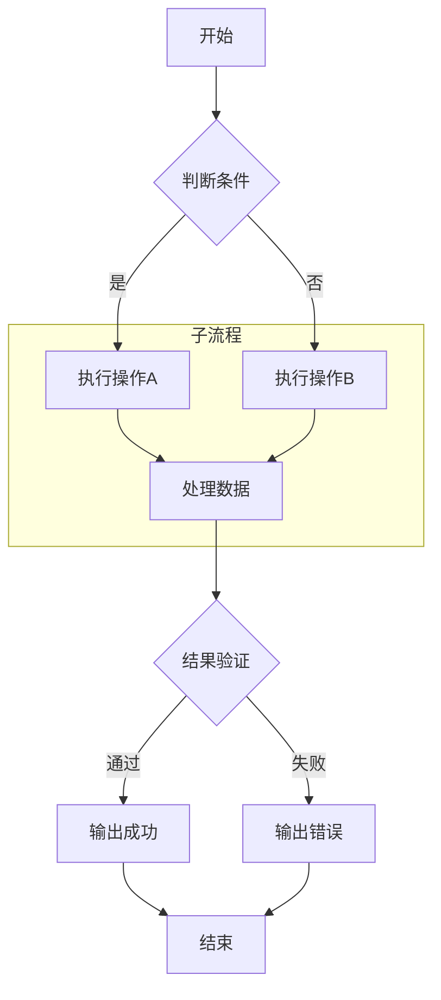

### 6.2 [时序图](https://mermaid.js.org/syntax/sequenceDiagram.html)

检查要点：实线、虚线、空心三种箭头区分清晰；参与者与生命线对齐；消息文字在深浅主题下均可读。

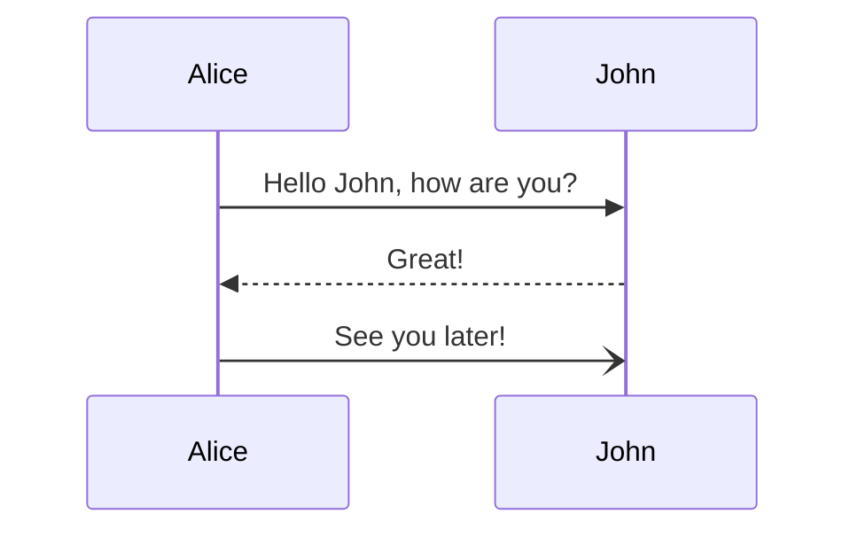

### 6.3 [类图](https://mermaid.js.org/syntax/classDiagram.html)

检查要点：继承箭头方向正确；public / private 符号显示完整；方法名后的括号不丢失。

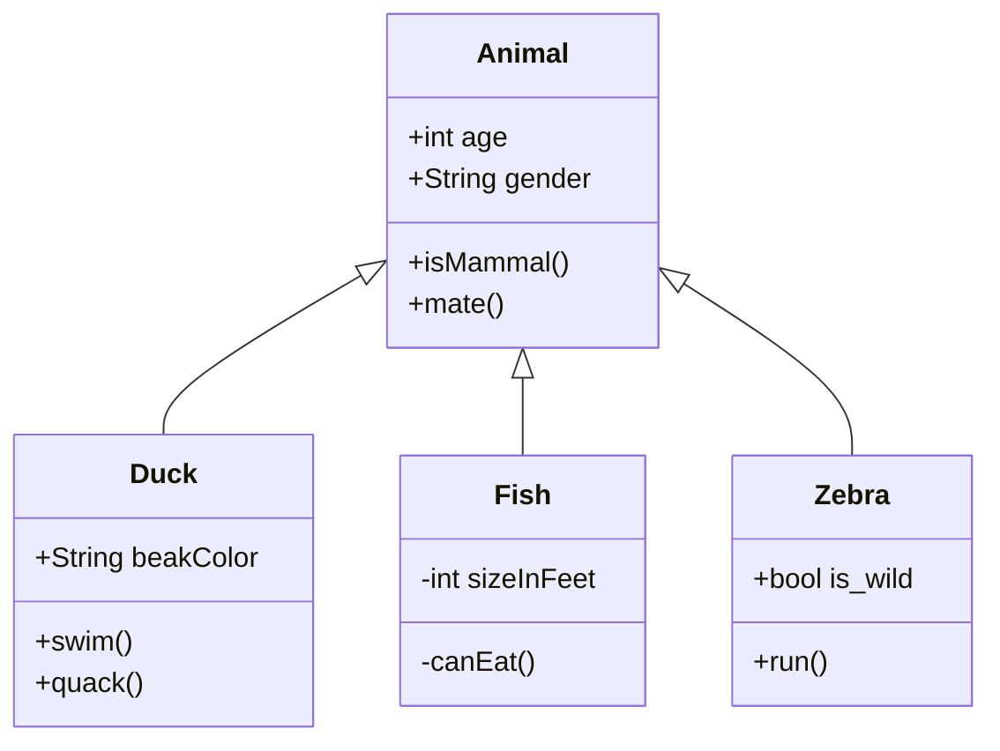

### 6.4 [状态图](https://mermaid.js.org/syntax/stateDiagram.html)

检查要点：起始态与终止态为实心圆；状态迁移箭头与标签齐全。

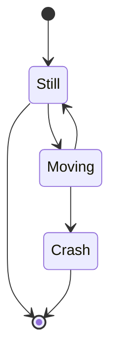

### 6.5 [实体关系图](https://mermaid.js.org/syntax/entityRelationshipDiagram.html)

检查要点：基数标注渲染正确；实体框内属性文字对齐（ER 配色走 mermaid v2 渲染器官方主题键 `mainBkg`/`attributeBackgroundColorOdd/Even` 等注入，重点回归配色）。

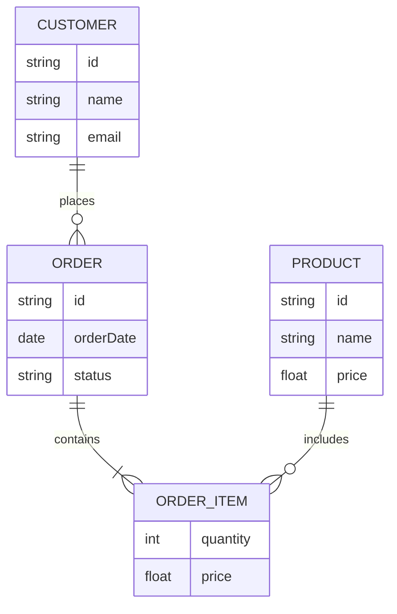

### 6.6 [用户旅程图](https://mermaid.js.org/syntax/userJourney.html)

检查要点：分区标题与情绪分数显示；折线起伏方向与数据一致。分区色走官方 fillType0~7 键注入（分区标题文字经 SVG 后处理覆盖官方硬编码 #333），切换主题重点回归配色。

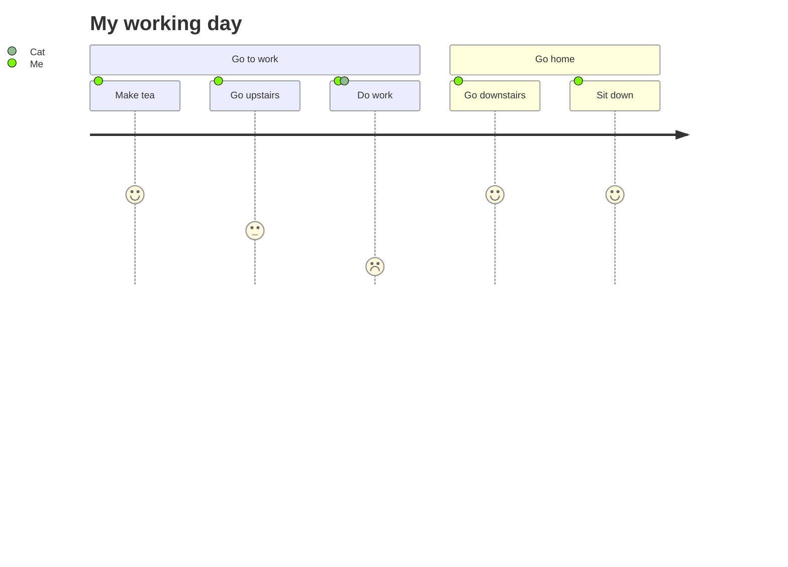

### 6.7 [甘特图](https://mermaid.js.org/syntax/gantt.html)

检查要点：任务条按日期排布；after 依赖关系正确连接；section 分组清晰。

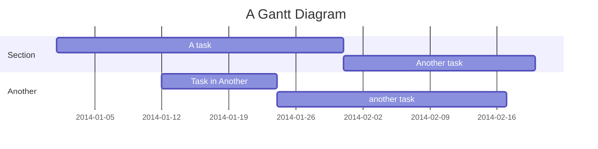

### 6.8 [饼图](https://mermaid.js.org/syntax/pie.html)

检查要点：扇区颜色取主题色阶；图例文字不重叠；数值标签可读。

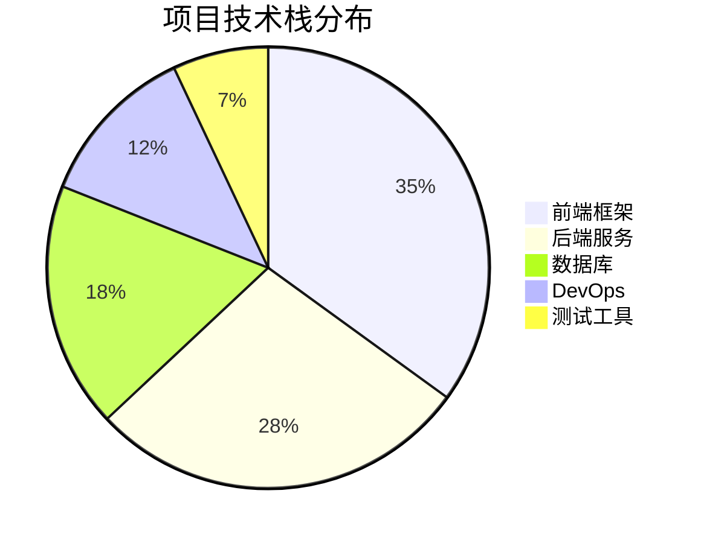

### 6.9 [象限图](https://mermaid.js.org/syntax/quadrantChart.html)

检查要点：四个象限标签位置正确；散点数据落在对应象限。四象限底色取主题状态色（绿/蓝/红/黄，对齐官方 Cynefin 语义），象限内文字按对比度自动取白/深墨（v41 暗色下状态色中亮致白字对比度 <4.5:1，已用 mixToward 向画布色加深 0.45 使白字达 AA）；**重点回归暗色主题下象限文字清晰度（6.9）与分区配色**。


### 6.10 [需求图](https://mermaid.js.org/syntax/requirementDiagram.html)

检查要点：需求框与元素框样式有区分；satisfies 关系箭头正确。关系线色（relationColor）取品牌系列色 chart-series-0（品牌橙 #FF6A2B），**重点回归关系线应为品牌橙、不再是偏青的中性色（6.10）**。

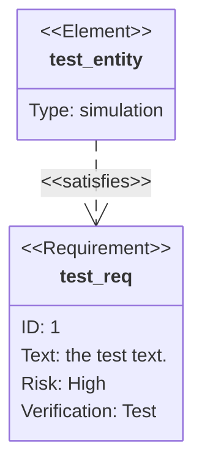

### 6.11 [Git 提交历史图](https://mermaid.js.org/syntax/gitgraph.html)

检查要点：提交节点与分支线取 gitGraph 专用主题变量（git0~7 逐分支品牌系列色 / gitBranchLabel0~7 / commitLabel* / tagLabel*）；主分支与提交点为主分支色（亮 #FF6A2B / 暗 #F2570F），逐分支绿/黄/蓝/紫/红分明；分支创建与合并位置正确。**v41 已删 over-broad 后处理压色规则——分支线不再被压成中性灰（曾被读作青色），重点回归 6.11 各分支线为对应品牌色、无青色残留**。

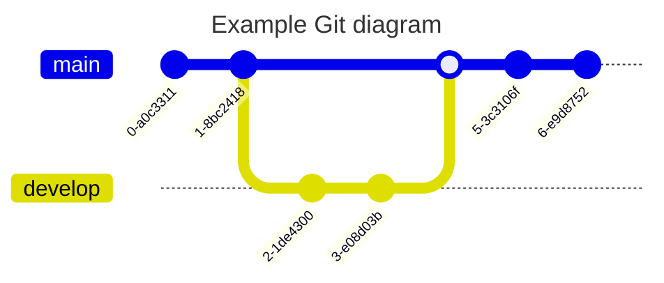

### 6.12 [C4 架构图](https://mermaid.js.org/syntax/c4.html)

检查要点：嵌套边界框层次清晰；关系线与标签可读。C4 不支持 themeVariables，配色依赖源码内样式声明，为重点回归项。

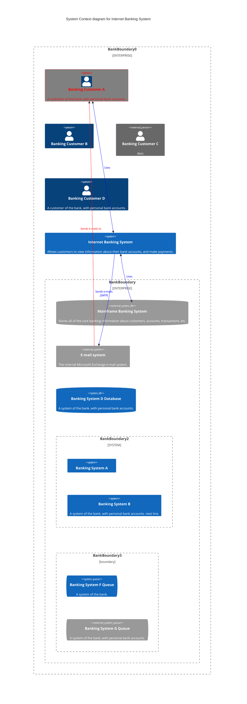

### 6.13 [思维导图](https://mermaid.js.org/syntax/mindmap.html)

检查要点：布局默认为发散（放射），可在「阅读选项 → 思维导图布局」三选一切换：发散（cose-bilkent 放射）/ 层级树（dagre TB，根在上分支垂下）/ 横向逻辑图（dagre LR，中心在左、全分支朝右，v42 经注册包装布局把 data4Layout.direction 改 LR 委托 dagre 渲染器实现，mermaid 12.2.0 原生方向硬编码 TB 无配置口）。新增「思维导图样式」（同菜单，v42 引入，默认 brand）：① brand=逐分支强调色实底 + 层级向画布渐变 + 无下划线 + 文字按对比度自动取墨（最能体现主题特色）；② depth=单色按层级明度推进（原生 colorBy='depth'）；③ outline=透明底 + 彩色描边/文字；④ classic=低饱和底 + 彩色下划线（历史默认）。**重点回归**：切主题/切样式/切布局后节点文字对比度（≥4.5:1）、branches 各色相无串色、brand 深层较浅/较暗的层级渐变清晰、depth 单色逐层可辨、横向逻辑图连线与节点方向一致（全朝右）；视觉观感由实机确认。

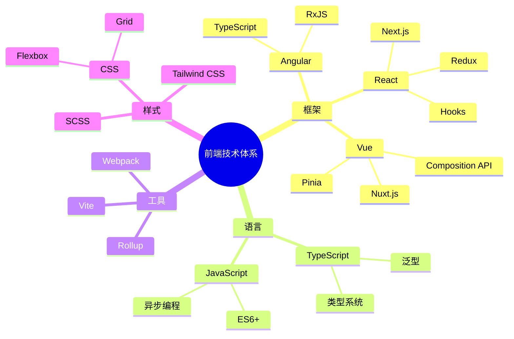

### 6.14 [时间线](https://mermaid.js.org/syntax/timeline.html)

检查要点：各年份事件文字不溢出；时间轴刻度与分段均匀。分区色走官方 cScale 系列注入（12 槽循环 + 根节点 git0 键），重点回归分区配色。

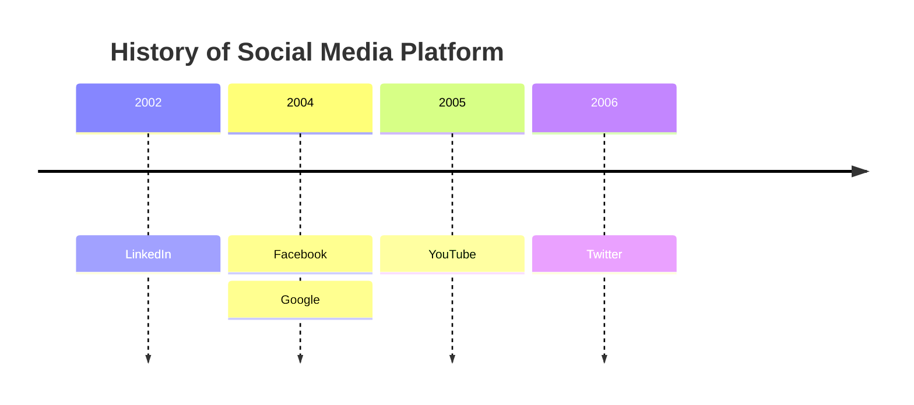

### 6.15 [ZenUML](https://mermaid.js.org/syntax/zenuml.html)

检查要点：try / catch / finally 三种片段框与消息线齐全；ZenUML 插件按需懒加载，仅在本节出现 zenuml 关键字时触发；主题适配依赖 SVG 后处理注入，切换主题后重点回归。

> **支持**：ZenUML 通过外部插件 `@mermaid-js/mermaid-zenuml@1.0.1` 注册到 Mermaid 12.2.0。依赖包含 `@zenuml/core@^3.47.9`，启动时按需懒加载，仅检测到 `zenuml` 关键字时才加载插件代码。
>
> **主题适配**：ZenUML 插件不接受 mermaid 的 `themeVariables`（源码中无任何 `themeVariables` 引用），且输出 SVG 使用内联 `style="fill:..."` 硬编码颜色，CSS 变量无法生效。本项目通过 `MermaidDiagram.tsx` 中 SVG 后处理注入 `!important` 规则实现主题适配，覆盖以下元素：参与者方块、参与者/构造型文字、生命线、消息线/文字、序号、Fragment 框/标题/分隔符/区段、Return 线/箭头/标签/图标。

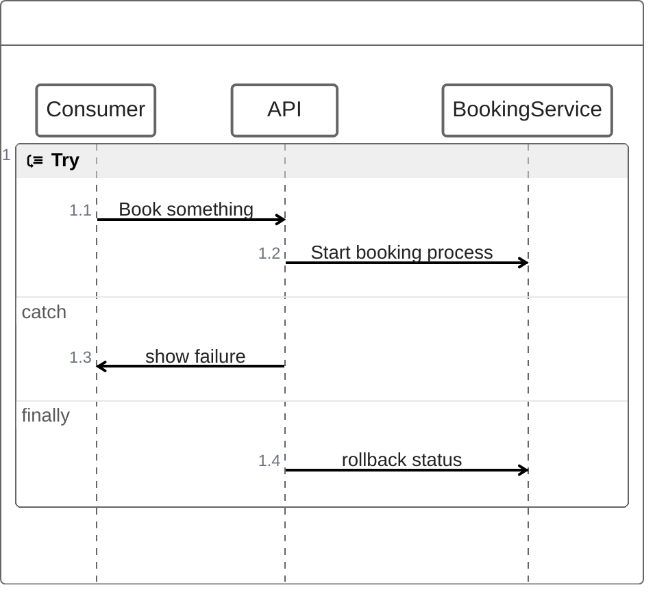

### 6.16 [桑基图](https://mermaid.js.org/syntax/sankey.html)

检查要点：节点与流量带对齐；config 中 showValues 开关行为符合声明；中文节点名不缺失字符。

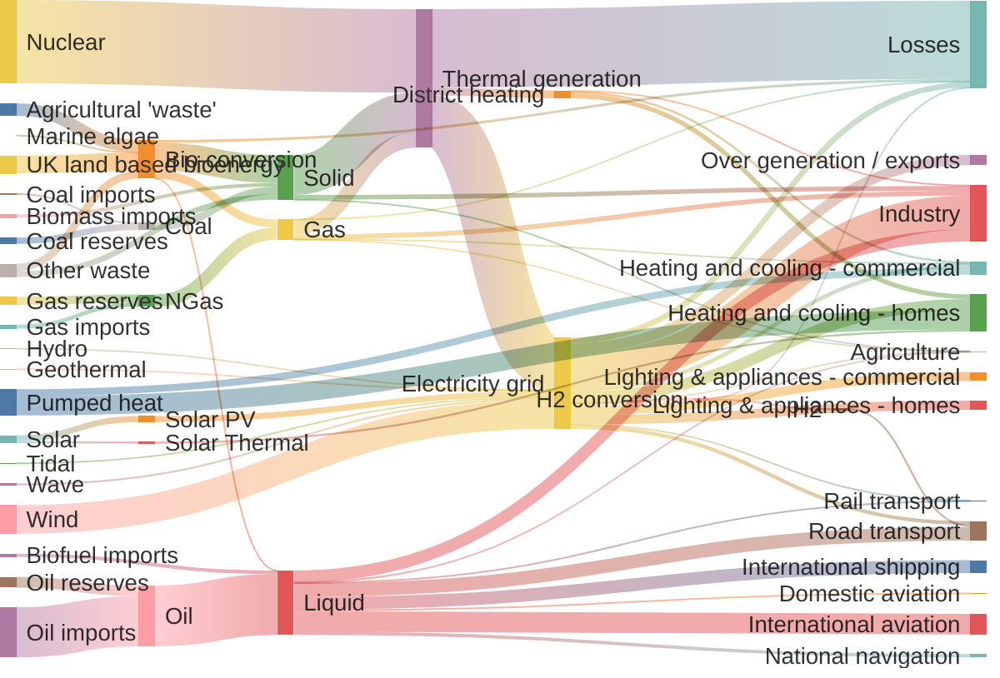

### 6.17 [XY 图表](https://mermaid.js.org/syntax/xyChart.html)

检查要点：柱状与折线双系列叠加显示；坐标轴刻度、标题与图例正确。

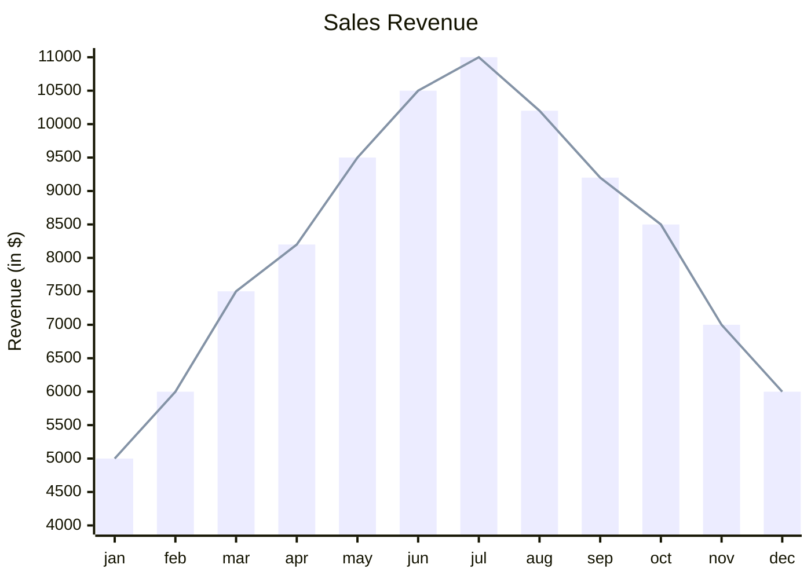

### 6.18 [块图](https://mermaid.js.org/syntax/block.html)

检查要点：上下箭头方向正确；block 内多节点排列符合列声明；行内 style 样式生效。

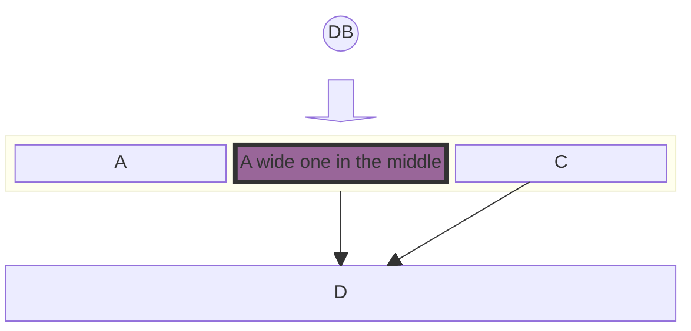

### 6.19 [数据包图](https://mermaid.js.org/syntax/packet.html)

检查要点：位段标签不重叠；位范围与名称一一对应。Packet 图的 themeVariables 存在上游缺陷，配色依赖 SVG 后处理，为重点回归项。

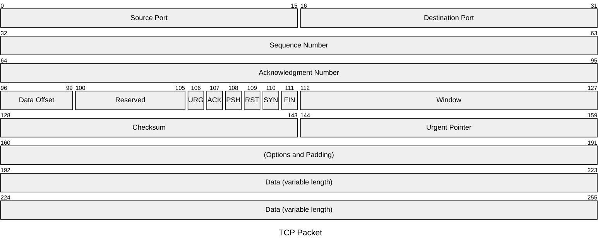

### 6.20 [看板图](https://mermaid.js.org/syntax/kanban.html)

检查要点：各列与卡片层次清晰；卡片元数据（负责人、优先级）完整显示。卡片文字走 cScale 主题色阶，亮/暗对比度实测定达标（亮 ~19:1 / 暗 ~5.7:1）。**注意：6.20 文字「不清晰」疑为 v39 前旧构建缓存（kanban 曾死键回退 mermaid 默认深蓝/紫填充）；若重建后仍有问题再报，重点回归重建后实机配色**。

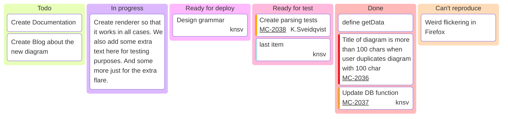

### 6.21 [架构图](https://mermaid.js.org/syntax/architecture.html)

检查要点：群组嵌套边界正确；T / B / L / R 四向连接的箭头方向与声明一致。

```mermaid
architecture-beta
    %% 定义一个顶级群组：云端 VPC
    group vpc(cloud)[Public VPC]

    %% 在 VPC 组内定义服务
    service gateway(internet)[Internet Gateway] in vpc
    service auth_server(server)[Auth Server] in vpc
    
    %% 定义一个嵌套子组：私有子网
    group private_subnet(cloud)[Private Subnet] in vpc
    
    %% 在子组内定义数据库和存储
    service main_db(database)[Main DB] in private_subnet
    service backup_disk(disk)[Backup Disk] in private_subnet
    
    %% 定义一个交汇点，用于多路连接
    junction router in vpc

    %% 建立连接 (使用 L|R|T|B 指定方向)
    gateway:B -- T:router
    router:L -- R:auth_server
    router:B -- T:main_db
    
    %% 数据库到磁盘的单向带箭头连接
    main_db:R --> L:backup_disk

```

### 6.22 [雷达图](https://mermaid.js.org/syntax/radar.html)

检查要点：多条曲线颜色取 cScale 系列且可区分；坐标轴标签不溢出。

```mermaid
radar-beta
  title Restaurant Comparison
  axis food["Food Quality"], service["Service"], price["Price"]
  axis ambiance["Ambiance"]

  curve a["Restaurant A"]{4, 3, 2, 4}
  curve b["Restaurant B"]{3, 4, 3, 3}
  curve c["Restaurant C"]{2, 3, 4, 2}
  curve d["Restaurant D"]{2, 2, 4, 3}

  graticule polygon
  max 5
```

### 6.23 [事件建模图](https://mermaid.js.org/syntax/eventmodeling.html)

检查要点：ui / cmd / evt 三类色块区分明显；data 定义块渲染完整。

> **支持说明**：Event Modeling 自 Mermaid 11.15.0 起内置（关键字 `eventmodeling`），当前项目使用 Mermaid 12.2.0，无需外部插件。

```mermaid
eventmodeling

tf 01 ui CartUI
tf 02 cmd AddItem [[AddItem01]]
tf 03 evt ItemAdded [[ItemAdded]]
tf 04 cmd AddItem [[AddItem02]]
tf 05 evt ItemAdded [[ItemAdded]]

data AddItem01 {
  description: 'john'
  image: 'avatar_john'
  price: 20.4
}

data AddItem02 {
  description: 'jack'
  image: 'avatar_jack'
  price: 12.5
}

data ItemAdded {
  description: string
  image: string
  price: number
}
```

### 6.24 [树状图](https://mermaid.js.org/syntax/treemap.html)

检查要点：矩形面积与数值成比例；classDef 自定义样式（红色填充）生效。

```mermaid
treemap-beta
"Section 1"
    "Leaf 1.1": 12
    "Section 1.2":::class1
      "Leaf 1.2.1": 12
"Section 2"
    "Leaf 2.1": 20:::class1
    "Leaf 2.2": 25
    "Leaf 2.3": 12

classDef class1 fill:red,color:blue,stroke:#FFD600;

```

### 6.25 [维恩图](https://mermaid.js.org/syntax/venn.html)

检查要点：两圆交集区域可见；text 标签定位在圆内；行内 style 覆盖生效。

```mermaid
venn-beta
  set A["Alpha"]:20
    text A1["React"]
    text A2["Design Systems"]
  set B["Beta"]:12
  union A,B["AB"]:3
  style A fill:#ff6b6b
  style A,B color:#333
  style A1 color:red

```

### 6.26 [石川图](https://mermaid.js.org/syntax/ishikawa.html)

检查要点：鱼骨主干与多级原因分支齐全；四大分类标题对齐清晰。

```mermaid
ishikawa-beta
    Blurry Photo
    Process
        Out of focus
        Shutter speed too slow
        Protective film not removed
        Beautification filter applied
    User
        Shaky hands
    Equipment
        LENS
            Inappropriate lens
            Damaged lens
            Dirty lens
        SENSOR
            Damaged sensor
            Dirty sensor
    Environment
        Subject moved too quickly
        Too dark

```

### 6.27 [沃德利地图](https://mermaid.js.org/syntax/wardley.html)

检查要点：价值链两轴方向正确；四种连接线型（箭头、加粗箭头、双向、带标签）区分清晰。

```mermaid
wardley-beta
title Link Types

component User [0.90, 0.95]
component App [0.75, 0.75]
component API [0.60, 0.60]
component Cache [0.65, 0.45]
component Database [0.15, 0.80]

User -> App
App +> API
API -> Database
API +<> Cache
Cache +'backup'> Database
```

### 6.28 [树形视图](https://mermaid.js.org/syntax/treeView.html)

检查要点：目录树层级缩进正确；节点文字对齐；引号内名称完整显示。treeView 官方仅消费通用 textColor/lineColor（图标 fill=currentColor 随文字色），主题适配为文字/连线级。

```mermaid
treeView-beta
    "my-project"
        "src"
            "App.tsx"
            "index.js"
        ".env"
        "Dockerfile"
        "package.json"
```

### 6.29 [泳道图](https://mermaid.js.org/syntax/swimlanes.html)

检查要点：顶层 subgraph 渲染为泳道并按责任分组；跨泳道箭头表示工作交接（如 Support 到 Engineering）；节点沿用流程图形状语法（矩形、菱形、圆形）；该类型为 v11.16.0+ 新增，已注入 cluster / 节点 / 连线主题变量（mermaid-swimlane.css），切换主题后重点回归泳道分隔与文字可读性。连线标签底色走官方 edgeLabelBackground 键（v39 修复黑底色块）。

```mermaid
swimlane-beta LR
    subgraph Customer
        request[Request service]
        receive[Receive update]
    end
    subgraph Support
        triage[Triage request]
        answer[Send answer]
    end
    subgraph Engineering
        investigate[Investigate issue]
        fix[Prepare fix]
    end
    request --> triage
    triage -->|Known issue| answer
    triage -->|Needs code change| investigate
    investigate --> fix --> answer
    answer --> receive
```

### 6.30 [用例图](https://mermaid.js.org/syntax/usecase.html)

检查要点：actor 小人图标与用例椭圆、systemBoundary 边界分组；include / extend / 泛化使用专门操作符（`..> : include`、`..> : extend`、`--|>`）而非普通箭头；**`direction` 必须单独一行**——官方文档示例将其与 `usecase-beta` 写在同一行，在项目锁定的 12.2.0 上会解析失败，勿照抄；该类型为 v12.0.0+ 新增，已注入 usecase* 主题变量（mermaid-usecase.css），切换主题后重点回归参与者 / 用例 / 边界的配色区分与文字可读性。

```mermaid
usecase-beta
    direction LR
    actor Customer
    actor Support
    systemBoundary Storefront
        Browse("Browse catalogue")
        Checkout("Checkout")
    end
    systemBoundary Fulfilment
        Track("Track delivery")
    end
    Customer --> Browse
    Customer --> Checkout
    Customer --> Track
    Support --> Track
    Checkout ..> : include Browse
```

### 6.31 [Cynefin 框架图](https://mermaid.js.org/syntax/cynefin.html)

检查要点：五个域位置固定（Complex 左上、Complicated 右上、Chaotic 左下、Clear 右下、Confusion 中心）；条目为引号徽标，Confusion 椭圆最多显示 3 条并带 +N 溢出标记；域间转换为带标签箭头（如 clear --> chaotic : "Complacency"）；该类型为 v11.16.0+ 新增，已注入 themeVariables.cynefin 嵌套主题变量（mermaid-cynefin.css）：五域底色取主题状态色（复杂=ok 绿 / 繁杂=info 蓝 / 混乱=danger 红 / 清晰=warn 黄 / 中心=queued 紫，对齐官方渲染语义），条目徽标与域标签压在同色域底色上，文字色按 WCAG 对比度自动取白/深墨；切换主题后重点回归波浪边界、五域填充与文字可读性。

```mermaid
cynefin-beta
    title Strategy Categorization
    complex "Market research"
    complicated "Competitive analysis"
    clear "Standard pricing"
    chaotic "Crisis management"
    complex --> complicated : "Pattern identified"
    complicated --> clear : "Best practice codified"
    clear --> chaotic : "Complacency"
    chaotic --> complex : "Stabilized"
```

***

## 七、目录（TOC）

检查要点：`[TOC]` 标记是否生成可点击目录；目录层级与文档标题结构一致；点击目录项是否滚动到对应位置；若支持当前章节高亮，确认其随滚动更新。

[TOC]

***

## 八、脚注

检查要点：正文中的脚注引用是否变为上标数字；页面底部是否出现对应脚注列表；点击引用与脚注是否互相跳转；较长脚注的多行内容完整显示。

这是一个包含脚注的文本[^1]，也可以有多个脚注[^2]。长文本支持[^long]。

[^1]: 这是第一个脚注的内容。

[^2]: 这是第二个脚注的内容，可以包含更多文字。

[^long]: 这是一个较长的脚注，可以包含多行内容。脚注在文档末尾显示，点击上标可以跳转到对应位置。

***

## 九、锚点链接（页内跳转）

本章验证页内跳转。检查要点：点击链接后是否滚动到目标位置而非整页刷新；目标标题最终停在视口可见区域，不被顶部固定元素遮挡。

### 9.1 标题锚点

检查要点：两个中文标题生成的锚点（含英文、数字与标点）能被正确解析；跳转后目标位于视口内。

跳转到 [六、Mermaid 图表](#六mermaid-图表)

跳转到 [4.3 表格内使用 Markdown](#43-表格内使用-markdown)

### 9.2 自定义锚点

检查要点：HTML 自定义锚点生效；从其他章节跳转回来时位置准确。

<a id="custom-anchor"></a>
这里有一个自定义锚点，可以通过链接跳转到这里。

[跳转到自定义锚点](#custom-anchor)

***

## 十、上标与下标

本章演示上标与下标语法。检查要点：上标与下标以更小字号渲染且基线偏移方向正确；化学式与数学下标序列不出现解析断裂；与正文混排时行高不被撑乱。

### 10.1 上标

检查要点：质能方程的上标渲染为正确的上标样式；若样例显示为字面量符号（如脱字符原样可见），记录为异常。

H\~2\~O 是水的化学式，E = mc^2^ 是质能方程。

### 10.2 下标

检查要点：碳酸钠与数学下标的样例渲染为正确的下标样式；若显示为字面量波浪号，记录为异常。

化学元素：Na\~2\~CO\~3\~（碳酸钠），数学下标：x\~1\~, x\~2\~, ..., x\~n\~

***

## 十一、Admonition 提示框

以下样例演示九种提示框。检查要点：每种类型有区别于普通引用的图标与配色；类型标记行（NOTE / TIP 等）不显示为正文；提示框内多行内容排版整齐；深浅主题下背景色与文字对比充足。

> [!NOTE]
> 这是一个提示框，用于展示一般性的注意事项。

> [!TIP]
> 这是一个技巧提示框，用于展示实用的小技巧。

> [!WARNING]
> 这是一个警告提示框，用于提醒用户注意可能存在的风险。

> [!CAUTION]
> 这是一个严重警告提示框，用于提醒用户可能造成的严重后果。

> [!IMPORTANT]
> 这是一个重要信息提示框，用于展示关键信息。

> [!INFO]
> 这是一个信息提示框，用于展示补充说明信息。

> [!SUCCESS]
> 这是一个成功提示框，用于展示操作成功的信息。

> [!ERROR]
> 这是一个错误提示框，用于展示操作失败或错误信息。

> [!DANGER]
> 这是一个危险提示框，用于展示可能导致严重后果的警告。

***

## 十二、自动链接识别

检查要点：裸 URL 与邮箱地址被自动识别为可点击链接；协议头显示完整；链接文字不错误地包含尾部标点。

标准的 URL 会被自动识别为链接，无需方括号：

<https://www.example.com>

<http://example.org>

[www.example.com](http://www.example.com)

邮箱地址也会被自动识别：

<contact@example.com>

<support@company.org>

***

## 十三、HTML 标签（部分解析器支持）

本章演示行内与块级 HTML。检查要点：自定义容器样式生效；折叠组件点击可展开与收起；HTML 注释不显示；abbr 的 title 悬停提示正常；HTML 块不破坏周围的 Markdown 结构。

<div style="border: 1px solid #ccc; padding: 16px; border-radius: 8px; background: #f9f9f9;">
  <h4 style="color: #3b82f6; margin-top: 0;">自定义 HTML 容器</h4>
  <p>这是通过 HTML 标签嵌入的内容，可以用来实现 Markdown 不直接支持的样式。</p>
</div>

<br />

<details>
<summary>点击展开详细内容</summary>

这是折叠的详细内容，点击后可以展开查看。可以包含任何 Markdown 内容：

- 列表项一
- 列表项二
- **粗体** 和 *斜体* 也可以

</details>

<br />

<mark>高亮标记文本</mark>

<abbr title="HyperText Markup Language">HTML</abbr> 是一种标记语言。

<!-- 这是一条 HTML 注释，不会显示 -->

***

## 十四、嵌套结构

本章演示列表与引用嵌套代码块等复合结构，是分块解析器的重点回归区域。检查要点：嵌套代码块的缩进与归属正确；引用内有序列表的编号连续；复合结构在虚拟滚动下不错位。

### 14.1 列表嵌套代码块

检查要点：三段代码块分别归属对应列表项；代码块前后的列表编号保持连续。

1. 安装依赖：
   ```bash
   npm install express
   ```
2. 创建服务器：
   ```javascript
   const express = require('express');
   const app = express();
   app.get('/', (req, res) => res.send('Hello World!'));
   app.listen(3000);
   ```
3. 访问 `http://localhost:3000`

### 14.2 引用嵌套列表与代码

检查要点：引用内的有序列表与两级代码块渲染层级正确；配置示例内容完整可见。

> 配置步骤：
>
> 1. 创建配置文件 `config.json`
>    ```json
>    {
>      "port": 8080,
>      "host": "localhost"
>    }
>    ```
> 2. 设置环境变量：
>    ```bash
>    export APP_ENV=production
>    ```
> 3. 启动服务：`npm start`

***

## 十五、特殊内容

本章演示 Emoji、键盘按键、缩写与更多数学公式等零散特性。检查要点：各项能渲染且不破坏周围段落；暂不支持的项有合理降级而非报错。

### 15.1 Emoji

检查要点：短横线语法（如 `:+1:`）被替换为对应表情；注意部分别名不被识别（如 `:thumbsup:`），以实际支持列表为准。

:smile: :heart: :+1: :rocket: :fire: :100: :coffee: :bulb: :star: :tada: :muscle: :sparkles:

### 15.2 键盘按键

检查要点：kbd 元素呈现为按键样式（边框或背景）；组合键之间的加号间距正常。

按 <kbd>Ctrl</kbd> + <kbd>C</kbd> 复制，<kbd>Ctrl</kbd> + <kbd>V</kbd> 粘贴。

### 15.3 缩写

检查要点：正文中的 HTML、CSS、API 首次出现时带悬停提示；缩写定义行本身不显示在正文中（历史上曾出现定义漏出问题，重点回归）。

\*\[HTML]: HyperText Markup Language
\*\[CSS]: Cascading Style Sheets
\*\[API]: Application Programming Interface

HTML 和 CSS 是前端开发的基础，API 是后端提供的能力。

### 15.4 数学矩阵和公式（更多示例）

检查要点：薛定谔方程、贝叶斯定理与麦克斯韦方程组的希腊字母、粗体向量渲染正确；转义下划线（如 `\_0`）被正确消费，不出现字面量反斜杠或渲染断裂。

薛定谔方程：

$$
i\hbar\frac{\partial}{\partial t}\Psi(\mathbf{r},t) = \hat{H}\Psi(\mathbf{r},t)
$$

贝叶斯定理：

$$
P(A|B) = \frac{P(B|A) \cdot P(A)}{P(B)}
$$

麦克斯韦方程组：

$$
\nabla \cdot \mathbf{E} = \frac{\rho}{\varepsilon\_0}, \quad \nabla \cdot \mathbf{B} = 0
$$

$$
\nabla \times \mathbf{E} = -\frac{\partial \mathbf{B}}{\partial t}, \quad \nabla \times \mathbf{B} = \mu\_0\mathbf{J} + \mu\_0\varepsilon\_0\frac{\partial \mathbf{E}}{\partial t}
$$

***

*文档生成时间：2026-04-30*
*本文档涵盖了 Markdown 绝大多数语法元素，可用于阅读器功能完整性测试。*

这份文档覆盖了以下所有语法元素：

- **基础**：6级标题、段落、换行、粗体、斜体、粗斜体、删除线、行内代码
- **块级**：引用（含嵌套）、有序/无序/任务列表、分割线
- **链接与图片**：行内链接、带标题链接、自动链接、邮箱链接、引用式链接、行内/引用式/带链接图片、锚点链接（页内跳转）
- **代码**：行内代码、多语言代码块（Python / JS / JSON / Bash / CSS / Rust / TypeScript / Go / Java / SQL）、Diff 代码块
- **表格**：普通表格、三种对齐方式表格、表格内使用 Markdown
- **数学公式**：行内公式、块级公式、矩阵、分段函数、偏微分方程等
- **Mermaid 图表**：流程图、时序图、类图、状态图、ER图、用户旅程图、甘特图、饼图、象限图、需求图、Git 提交历史图、C4 架构图、思维导图、时间线、ZenUML、桑基图、XY图表、块图、数据包图、看板图、架构图、雷达图、事件建模图、树状图、维恩图、石川图、沃德利地图、树形视图、泳道图、用例图、Cynefin 框架图
- **扩展语法**：目录 \[TOC]、脚注、HTML标签（容器/折叠/高亮/键盘按键/自定义锚点）、转义字符、Emoji、嵌套结构、上标/下标、Admonition 提示框、自动链接识别、缩写

